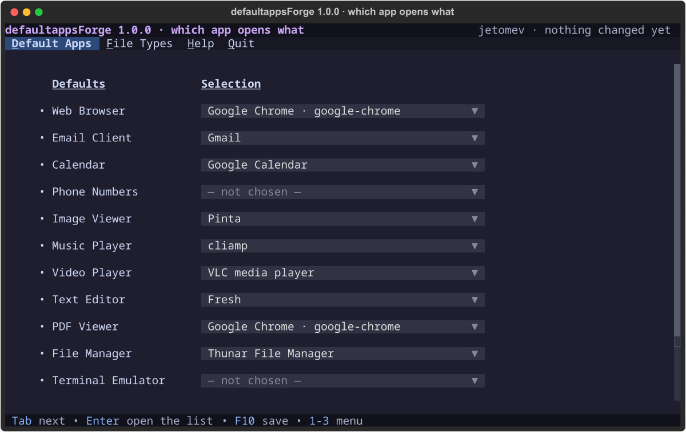
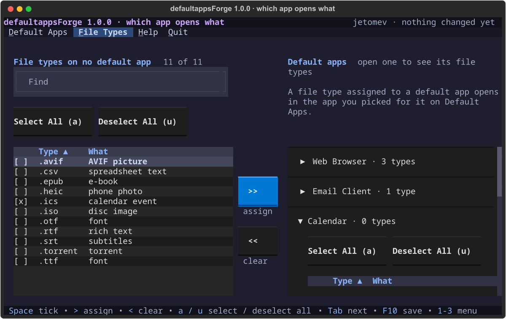
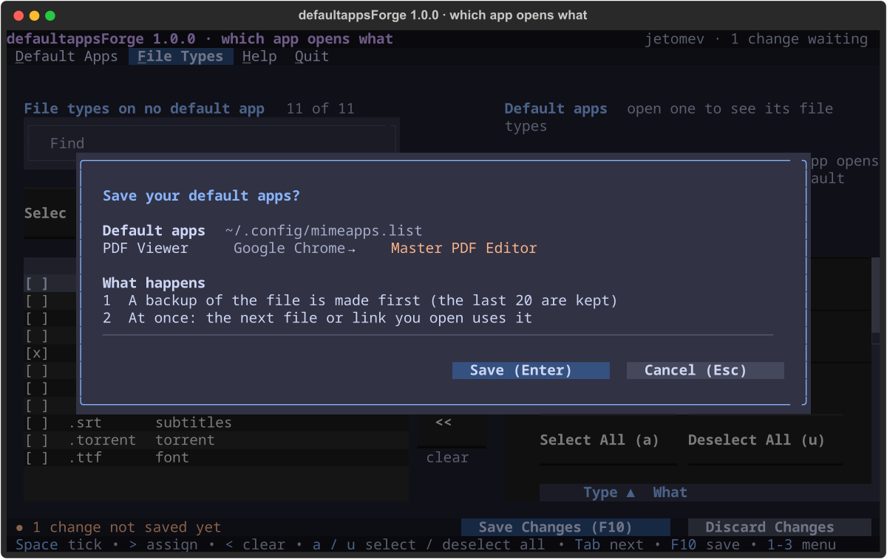

<p align="center">
  
</p>

<p align="center">
  
  
  <a href="https://aur.archlinux.org/packages/defaultappsforge"></a>
  
  
</p>

# defaultappsForge

**Which app opens what.** Links, email, calendar invites, folders, text, PDFs, pictures, music, video, documents and archives: see what opens each one today (your choice, or just the system's guess), spot old choices for apps that are gone, and pick. A terminal app, and the **Default apps** page of [hypeForge](../hypeforge/) Settings.

> 🖥 **Where it runs:** **any Linux distribution** · **any desktop, or none**: it writes the standard `~/.config/mimeapps.list` that Sway, KDE, GNOME and every app read · **any terminal, even a plain text console**.



## What it does

**Default Apps**: one drop-down per job, fourteen of them: Web Browser, Email Client, Calendar, Phone Numbers, Image Viewer, Music Player, Video Player, Text Editor, PDF Viewer, File Manager, Terminal Emulator, Archive Manager, Map and Office Suite. Each list shows the apps on this computer that say they can do that job, and what does it today.

- **Web apps as real choices**: Gmail and Outlook for email links, Google Calendar and Outlook's calendar for invites (and the desktop's calendar, where a click on a day opens that day), Google Maps and OpenStreetMap for addresses, Google Voice for phone numbers. Picking one makes a small launcher that opens the site in its own window of Chrome, Chromium, Brave, Edge or Vivaldi (or a tab of any other browser). A web app takes links, never files.
- **Any app…** at the end of every list: every installed app, in a list you can type to filter, for the app that can do the job but doesn't say so.
- **Find more…** opens [nogForge](../nogforge/) already searching for that kind of app, to install another one.
- **The terminal** follows the `xdg-terminal-exec` standard; saving installs it through nog when it's missing.

**File Types**: which app opens each kind of file, two tables side by side. Tick file types on the left, pick an app, and **>>** gives them to it; **<<** takes them back.



**Save (F10)** shows every change before anything is written, keeps a backup of the old file (the last 20, in `~/.config/defaultappsforge/backups/`), and applies at once: the next file or link you open uses it. Old choices for apps that are gone are tidied away. Quitting with something unsaved asks first.



**YouTube Music and Google Docs** are web apps too, but they can't open a file on your computer, so they're never anyone's default. They go in your app menu instead, with one command:

```
webapp-open --add youtube-music google-docs
```

## Install

From the AUR (KognogOS: through nog):

```
nog install defaultappsforge
```

Then `defaultappsforge`, or **defaultappsForge** in your app menu. On KognogOS it's also the **Default apps** page of hypeForge Settings.

```
defaultappsforge             open defaultappsForge
defaultappsforge --version   print the version
defaultappsforge --help      print this
```

Inside: **1–3** or **Ctrl** + the underlined letter move between pages; **Tab** moves between lists; **Enter** opens one; **F10** saves; **F1** opens the manual; **?** shows every key; **Q** quits.

**Needs:** Python, Textual, Rich, [forgekit](../forgekit/) 0.10.0 or newer, and nog for installing a missing app. `xdg-utils` (to read the system's guess and the default browser) and `xdg-terminal-exec` are optional. The full list, measured from the code: [docs/PACKAGING.md](docs/PACKAGING.md).

## Roadmap

- [ ] More web apps where a website can really do the job
- [x] **1.0.0** — web apps, Any app…, Find more…, App Library web apps, `--help` and `--version`, the launcher entry
- [x] **0.1.0** — Default Apps and File Types, the review before saving, backups, the terminal through xdg-terminal-exec, the Default apps page in hypeForge Settings

## Changelog

### v1.0.0 — October 28, 2026 · every job's choices (D-5)

- **Web apps as choices** for email, calendar, maps and phone numbers (Javier: *"I cannot select among the apps, for email or calendar, chrome (gmail.com apps) which should be available"*; his plan answer: *"all look good"*).
- **Any app…** and **Find more…** at the end of every list.
- **App Library web apps**: `webapp-open --add youtube-music google-docs` (and `--remove`).
- **`--help` and `--version`** answer without opening the app (before, any word opened it); a word it doesn't know is refused.
- **A launcher entry**, so it shows in every app menu (it opens in your terminal).
- Javier's run, 28 October: he set Gmail and Google Calendar himself and both work; Find more… and Any app… passed (*"NICE!!!"*). Tests: 47 (19 at 0.1.0), no warnings.

### v0.1.0 — October 9, 2026 · the first version, inside hypeForge Settings

- Default Apps (fourteen drop-downs) and File Types (two tables, >> and <<), a review before saving, backups, old choices for gone apps tidied, the terminal through xdg-terminal-exec, the manual. The design was approved before any code: *"WOW APP!!!!"* ([docs/design/](docs/design/)). Not released on its own.

*Every decision, newest first: [docs/DECISIONS.md](docs/DECISIONS.md) · the list: [TODO.md](TODO.md) · the tracking issue: [#19](https://github.com/jetomev/forge-suite/issues/19).*

## How this project is built

A human and AI collaboration: the screens were drawn and approved by Javier before any code, every change is tested (47 tests, on a copy of the settings file, so no test touches your choices), and the test matrices are in [testing/](testing/), published on purpose.

## Authors

**Javier ([@jetomev](https://github.com/jetomev))**: idea, direction, testing

**Claude (Anthropic)**: co-developer, architecture, implementation

## License & credits

GPLv3. Part of the [Forge Suite](../), on [forgekit](../forgekit/). It follows the freedesktop.org standards for default applications and file types; thanks to everyone who keeps them.
