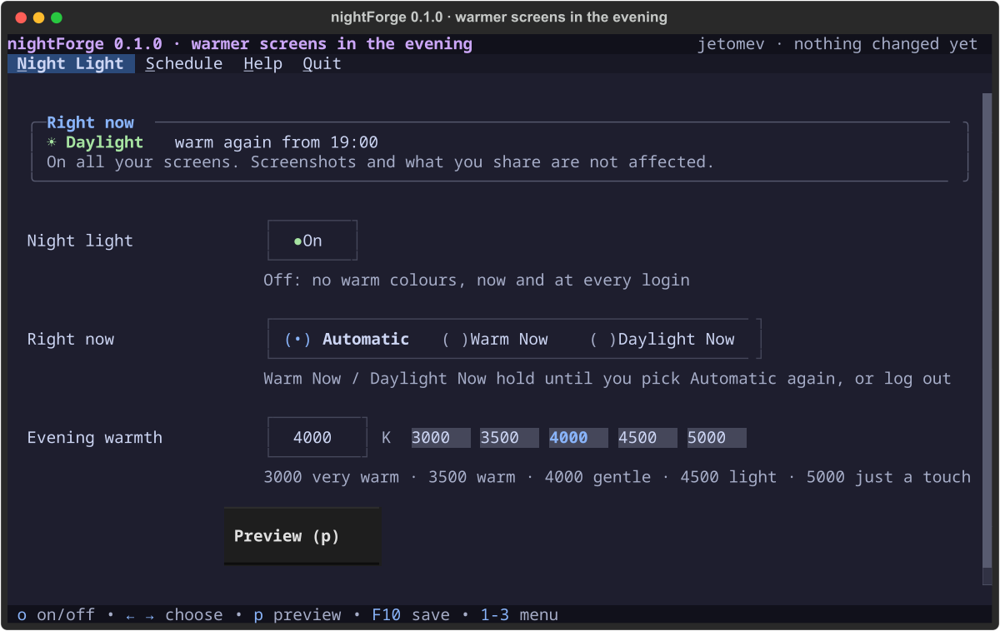
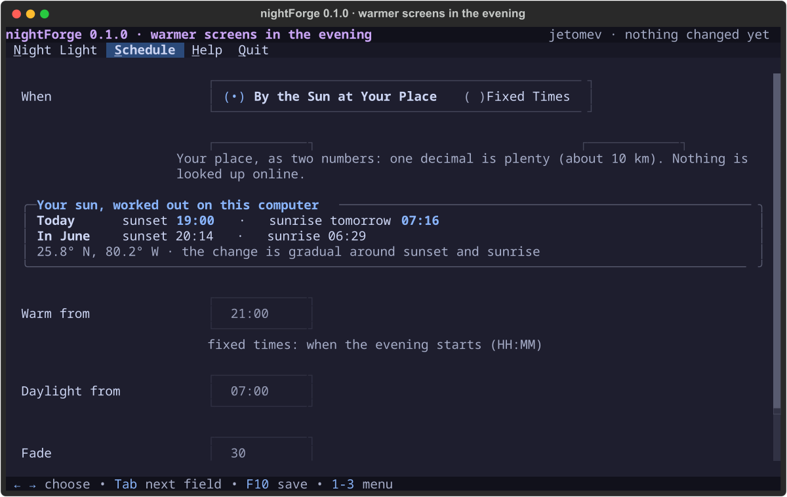

<p align="center">
  
</p>

<p align="center">
  
  
  
</p>

# nightForge

**Warmer screens in the evening, your way.** The night light's own app: switch it on or off, choose how warm the evening gets, and when (by the sun at your place, or fixed times). A terminal app, and the Night light page of hypeForge Settings.

> 🖥 **Where it runs:** made for **KognogOS's hypeForge desktop on Sway** (the night light, wlsunset, works on Sway and its wlroots family, not on KDE or GNOME) · **any terminal, even a plain text console**, where it edits the settings for the next login · written for KognogOS; needs Python, Textual, forgekit and wlsunset.

## How it looks

| Night Light | Schedule |
|---|---|
|  |  |

## Install and run

**Everything it needs** to build, run and test, with why, is in [docs/PACKAGING.md](docs/PACKAGING.md), measured from the code (the Forge Suite's [dependency audit](https://github.com/jetomev/forge-suite/issues/91), 2026-10-11).

```
yay -S nightforge
```

Then `nightforge`, the **Night light** page of hypeForge Settings, Quick Settings' Night light page (on hypeForge), or the tray icon (on other bars: on hypeForge's it steps aside, since the night light is in Quick Settings). At login hypeForge runs `nightforge start`.

## Status

**1.1.1, October 25, 2026.** What changed: [docs/CHANGELOG.md](docs/CHANGELOG.md) · next: [docs/ROADMAP.md](docs/ROADMAP.md) · decisions: [docs/DECISIONS.md](docs/DECISIONS.md) · the design: [docs/design/](docs/design/) · tests: [testing/](testing/) · the list: [TODO.md](TODO.md).

## License & credits

GPLv3. Built by Javier and Claude, part of the [Forge Suite](../), on [forgekit](../forgekit/). The night light itself is [wlsunset](https://sr.ht/~kennylevinsen/wlsunset/) by Kenny Levinsen; the sun times use NOAA's solar calculator formulas. Thank you both.
